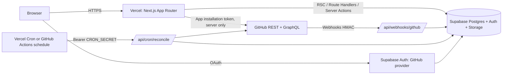

# System Architecture

> §4 of the OSS Club Website PRD
> Related docs: [PRD](./PRD.md) · [DATABASE_SCHEMA](./DATABASE_SCHEMA.md) · [GITHUB_INTEGRATION](./GITHUB_INTEGRATION.md) · [UI_UX_SPECIFICATION](./UI_UX_SPECIFICATION.md)

---

## System overview



---

## 4.1 Frontend

Next.js (App Router) · TypeScript strict · Tailwind (tokens via CSS vars) · shadcn/ui as base, **restyled** to our tokens · `next/font` · `motion` for animation (reduced-motion aware) · TanStack Query only on interactive client islands (portal filters); everything else is RSC.

### Rendering strategy

- Marketing pages = static + ISR (`revalidate` + `revalidateTag` from admin actions)
- Portal list = RSC reading Supabase cache with searchParams; client island for filter UX
- State in URL (searchParams) for all filters → shareable, back-button safe

---

## 4.2 Backend

- **Server Actions** for authenticated mutations from our own UI (forms, admin)
- **Route Handlers** for: webhooks, cron, public JSON (`/api/*`), OG images
- Layering: `app/` (thin) → `features/<domain>/{actions,queries,schemas,components}` → `lib/{github,supabase,auth,rbac}`. Zod schema at every boundary. No business logic in components.

---

## 4.3 Auth & authorisation

- **Supabase Auth, GitHub OAuth provider** (identity only: `read:user`, `user:email` optional). Login ≠ privileged GitHub access.
- **Org membership check** server-side with the App installation token: `GET /orgs/{org}/members/{username}` (or `memberships`), cached in `profiles.is_org_member`, refreshed on `organization`/`member` webhooks + login.
- **Role** stored in Supabase `user_roles`; enforced twice: server (`requireRole()`) and RLS.
- Admin writes use service-role client **only in server code** (`import 'server-only'`).

---

## 4.4 Deployment

- Vercel (Preview per PR, Production on `main`)
- Supabase project per env (`dev`, `prod`; local via Supabase CLI)
- GitHub App one per env (dev app + prod app)
- Secrets in Vercel env + GitHub Actions secrets; none in repo

---

## 4.5 Repository structure (greenfield)

```
OSS_website/
├─ .github/
│  ├─ ISSUE_TEMPLATE/{feature,bug,ui-ux,docs,tech-debt,integration}.yml
│  ├─ PULL_REQUEST_TEMPLATE.md   CODEOWNERS   dependabot.yml
│  └─ workflows/{ci.yml,e2e.yml,db-check.yml,reconcile.yml,labels-sync.yml}
├─ docs/{PRD,ARCHITECTURE,DATABASE_SCHEMA,GITHUB_INTEGRATION,UI_UX_SPECIFICATION,DEVELOPMENT_ROADMAP,GITHUB_WORKFLOW,GITHUB_ISSUES}.md
├─ supabase/{migrations/,seed.sql,config.toml,tests/}
├─ src/
│  ├─ app/(marketing)/ (public)/ (member)/ admin/ api/
│  ├─ components/{ui,layout,motion,brand}/
│  ├─ features/{projects,contribute,events,learn,team,recognition,admin}/
│  ├─ lib/{github,supabase,auth,rbac,env,utils}/
│  ├─ styles/{tokens.css,globals.css}
│  └─ types/
├─ tests/{unit,integration,e2e}/
├─ AGENTS.md   CONTRIBUTING.md   CODE_OF_CONDUCT.md   SECURITY.md   LICENSE
└─ package.json  pnpm-lock.yaml  next.config.ts  tsconfig.json  eslint.config.mjs  playwright.config.ts  vitest.config.ts
```

Module ownership boundaries (`features/*`) let members work in parallel with minimal merge conflicts; shared files (`tokens.css`, `lib/github`) are CODEOWNERS-protected.
