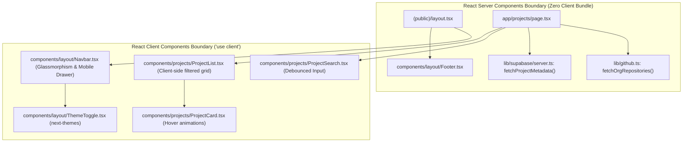
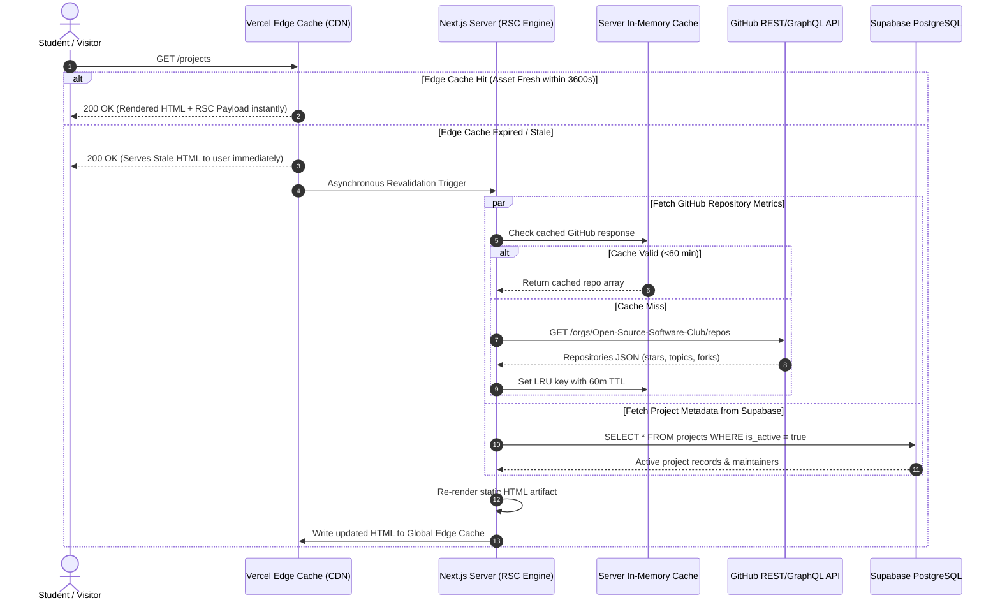
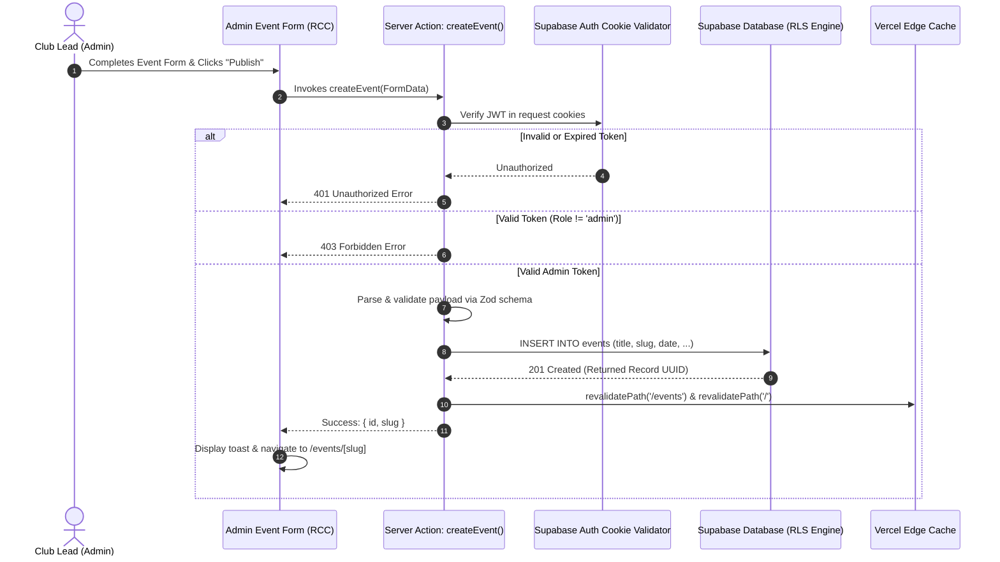
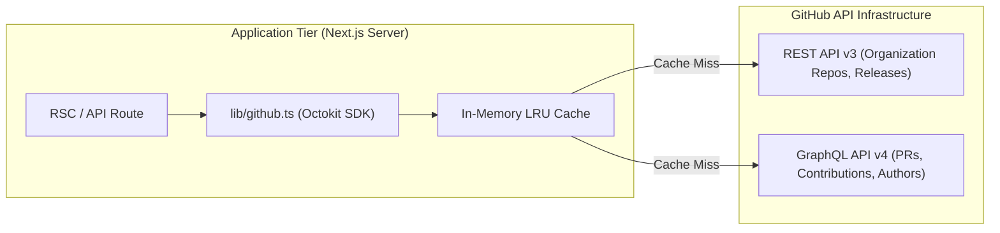
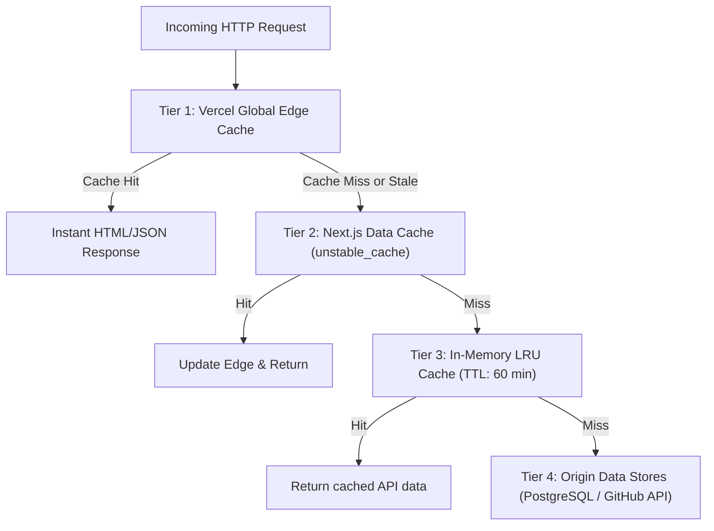
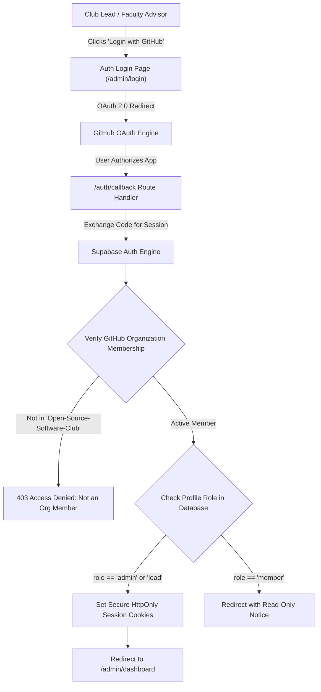
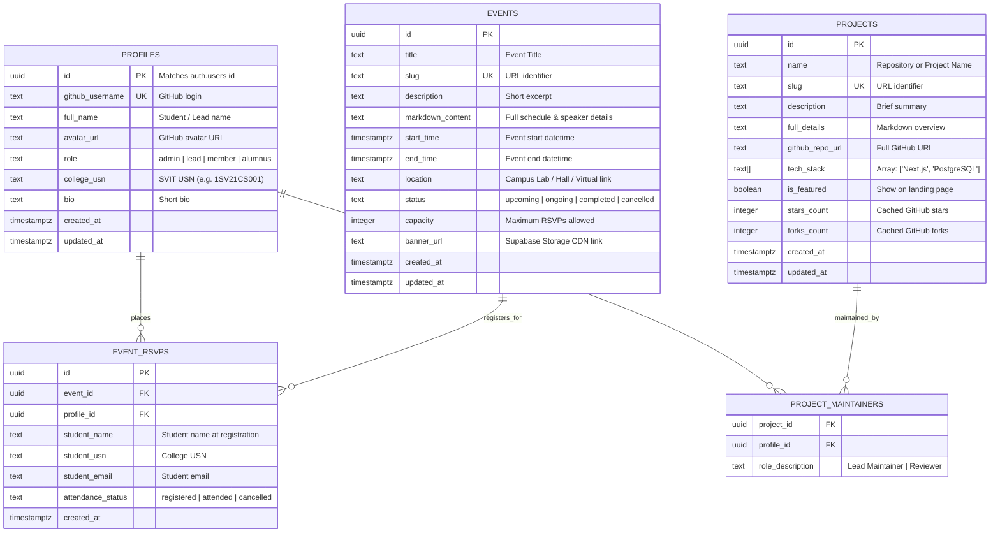
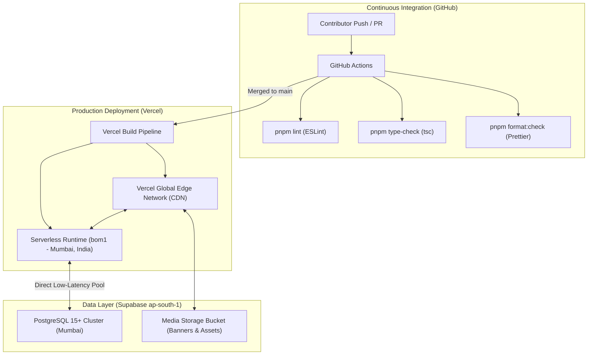

# Architecture & System Design

**Project**: Open Source Software Club Website  
**Institution**: Sai Vidya Institute of Technology (SVIT), Bengaluru  
**GitHub Organization**: [Open-Source-Software-Club](https://github.com/Open-Source-Software-Club)  
**Repository**: [OSS_website](https://github.com/Open-Source-Software-Club/OSS_website)  
**Tech Stack**: Next.js 14+ (App Router), React 18+, TypeScript 5+, Tailwind CSS 3.4+, shadcn/ui, Supabase (PostgreSQL), Vercel  
**Status**: Production-Ready Architectural Specification  

---

## 1. System Overview

The Open Source Software Club website serves as the primary digital anchor for student open-source collaboration, workshop orchestration, contributor tracking, project spotlights, and leadership administration at Sai Vidya Institute of Technology, Bengaluru.

The platform is designed around the following core engineering pillars:
* **High-Performance Static Delivery**: Pre-rendering public catalog pages with Incremental Static Regeneration (ISR) ensures sub-second page loads and resilience during campus events.
* **Autonomous GitHub Sync**: Automated server-side aggregation of organization statistics, repository rosters, pull request milestones, and contributor leaderboards without exposing client-side API credentials.
* **Role-Based Club Administration**: Secure admin backends allowing faculty advisors and student leads to manage workshops, announce hackathons, and maintain project catalogs.
* **Developer Ergonomics**: Modern component architecture using shadcn/ui primitives, strictly-typed schemas, and automated linting and formatting.

### 1.1 High-Level Architecture Diagram

```mermaid
graph TB
    subgraph Clients["Clients & Edge Tier"]
        Browser["User Browser (Desktop / Mobile)"]
        CDN["Vercel Global Edge Network (CDN)"]
    end

    subgraph Application["Next.js 14+ Application Tier (Vercel Mumbai)"]
        subgraph FrontendLayer["Frontend Layer (React 18 Server & Client Components)"]
            RSC["React Server Components (SSG / ISR / Zero-JS Leaf Nodes)"]
            RCC["React Client Components (Interactive Forms / Filters / Dialogs)"]
            ThemeStore["Theme & Session Context (next-themes / Supabase Auth)"]
        end

        subgraph BackendLayer["Server Layer (Next.js Route Handlers & Server Actions)"]
            RouteHandlers["API Route Handlers (/api/github/*, /api/events/*)"]
            ServerActions["Server Actions (Admin Mutations / Zod Validation)"]
            AuthEngine["Auth Middleware & Session Validator (@supabase/ssr)"]
            LRUCache["In-Memory LRU Cache (60m GitHub Aggregate Cache)"]
        end
    end

    subgraph Infrastructure["External Cloud Services"]
        GitHubAPI["GitHub API (REST v3 & GraphQL v4)"]
        subgraph SupabaseServices["Supabase Managed Cloud (ap-south-1)"]
            PostgreSQL["PostgreSQL 15+ (Row-Level Security)"]
            SupaAuth["Supabase Auth (GitHub OAuth 2.0 Provider)"]
            SupaStorage["Supabase Storage (Banners & Assets)"]
        end
        VercelMonitoring["Vercel Analytics & Speed Insights"]
    end

    Browser <-->|HTTPS / HTTP/2| CDN
    CDN <--> Application

    RSC -->|Hydrate with Cached Data| LRUCache
    RCC <-->|JSON Fetch / SWR| RouteHandlers
    RCC <-->|RPC Execution| ServerActions

    RouteHandlers <-->|Authenticated Octokit (PAT)| GitHubAPI
    RouteHandlers <-->|PostgREST Query| PostgreSQL
    ServerActions <-->|Admin Transaction| PostgreSQL

    AuthEngine <--> SupaAuth
    SupaAuth <-->|OAuth Handshake| GitHubAPI
    Application -.->|RUM Telemetry| VercelMonitoring
```

---

## 2. Technology Decisions & Rationale

| Layer | Technology | Considered Alternatives | Rationale & Trade-off Analysis |
| :--- | :--- | :--- | :--- |
| **Framework** | **Next.js 14+ (App Router)** | Vite + React SPA, Remix, Astro | Provides unified full-stack architecture with React Server Components (RSC), native Incremental Static Regeneration (ISR), automated image optimization, and route handlers. Ensures zero client JavaScript for static informational pages while supporting rich dynamic client-side interactivity. |
| **UI Library** | **React 18+** | Vue 3, Svelte 5 | Universal ecosystem adoption, deep integration with Next.js App Router streaming architecture, robust developer tooling, and direct alignment with current industry software engineering practices. |
| **Language** | **TypeScript 5+ (Strict)** | JavaScript (ESNext) | Guarantees end-to-end compile-time safety across database queries, GitHub API schemas, and UI props. Automated type generation from Supabase PostgreSQL tables eliminates runtime null pointer exceptions. |
| **Styling** | **Tailwind CSS 3.4+** | CSS Modules, Styled Components, Emotion | Utility-first architecture enforces design consistency through tokenized classes. Purges unused CSS at build time to produce ultra-small stylesheet bundles (<15KB gzipped). Eliminates CSS specificity clashes. |
| **Component Kit** | **shadcn/ui + Radix UI** | Material UI, Chakra UI, Ant Design | Headless, accessible (WAI-ARIA compliant) primitive components copied directly into the project repository. Zero black-box dependencies, completely themeable via CSS variables, and zero runtime style-injection penalties. |
| **Database & Auth** | **Supabase (PostgreSQL)** | MongoDB Atlas, Firebase, PlanetScale | Fully managed PostgreSQL with native Row-Level Security (RLS), real-time subscriptions, built-in GitHub OAuth authentication, and automated relational queries. Ideal collegiate infrastructure with zero vendor lock-in. |
| **Icons** | **Lucide React** | React Icons, FontAwesome | Modern, consistent stroke geometry (24px grid), tree-shakeable SVG exports, clean TypeScript definitions, and standard pairing with shadcn/ui. |
| **Package Manager**| **pnpm** | npm, yarn | Deterministic lockfiles, symlinked content-addressable storage preserving local storage, and prevention of phantom dependencies common in monorepos and multi-package setups. |
| **Hosting & CI/CD**| **Vercel** | AWS Amplify, Self-hosted VPS, Netlify | Native edge deployment optimization for Next.js, atomic preview environments on pull requests, built-in edge cache invalidation, and zero-maintenance automated SSL certificates. |

---

## 3. Frontend Architecture

### 3.1 Next.js App Router Structure

The frontend leverages Next.js App Router route groups to cleanly decouple public informational routes from authenticated administrative interfaces:

```text
src/
├── app/
│   ├── (auth)/
│   │   └── admin/
│   │       ├── login/
│   │       │   └── page.tsx              # Admin GitHub OAuth sign-in
│   │       └── dashboard/
│   │           ├── layout.tsx            # Protected admin navigation shell
│   │           ├── page.tsx              # Overview metrics & quick actions
│   │           ├── events/
│   │           │   ├── page.tsx          # Event management table
│   │           │   └── [id]/page.tsx     # Event editor
│   │           └── members/page.tsx      # Roster & role assignment
│   ├── (public)/
│   │   ├── layout.tsx                    # Shared header, navigation & footer
│   │   ├── page.tsx                      # Landing page (Hero, Stats, Highlights)
│   │   ├── about/page.tsx                # Club charter, faculty advisors, mission
│   │   ├── events/
│   │   │   ├── page.tsx                  # Public workshops & hackathons catalog
│   │   │   └── [slug]/page.tsx           # Event details, schedule & RSVP modal
│   │   ├── projects/
│   │   │   ├── page.tsx                  # Organization repositories showcase
│   │   │   └── [slug]/page.tsx           # Deep dive, tech stack, good-first-issues
│   │   ├── leaderboard/page.tsx          # Real-time contributor leaderboard
│   │   ├── team/page.tsx                 # Faculty advisors, club leads, alumni
│   │   └── resources/page.tsx            # Open-source roadmaps, Git guides
│   ├── api/                              # Route Handlers
│   ├── favicon.ico
│   ├── globals.css                       # Design tokens, CSS variables & utilities
│   ├── layout.tsx                        # Root HTML document, font loading
│   └── not-found.tsx                     # 404 Error boundary
├── components/
│   ├── ui/                               # Atomic shadcn/ui primitives
│   ├── layout/                           # Navbar, MobileNav, Footer, ThemeToggle
│   ├── home/                             # HeroSection, StatsBar, FeatureGrid
│   ├── projects/                         # ProjectCard, TechBadge, RepoFilter
│   ├── events/                           # EventCard, RSVPModal, EventCountdown
│   ├── leaderboard/                      # ContributorRankCard, MetricFilter
│   └── shared/                           # GlassCard, EmptyState, SkeletonLoader
├── hooks/                                # Custom client hooks (useDebounce, useMediaQuery)
├── lib/                                  # Utilities, GitHub API helpers, Supabase clients
├── types/                                # Database entities, GitHub payloads, UI types
└── styles/                               # Custom animation definitions
```

### 3.2 Component Hierarchy & Server/Client Boundary Strategy

The component hierarchy maintains a strict **Server-First** posture. React Server Components (RSC) fetch data and render markup on the server, while React Client Components (`'use client'`) handle interactive boundaries at the leaves.



* **Data Fetching Rule**: Server components execute asynchronous data calls directly via standard `async/await` without `useEffect` or client-side loading spinners.
* **Props Serialization**: Data passed across the Server-to-Client boundary must consist of plain JSON-serializable primitives, objects, or arrays.

---

## 4. Backend Architecture

### 4.1 Route Handlers & Server Actions

The backend runtime executes inside Vercel's Node.js 18+ Serverless Environment, providing two interaction patterns:

#### A. Route Handlers (`src/app/api/...`)
Used for external integrations, third-party webhooks, and public JSON consumption:
* `GET /api/github/org-stats`: Aggregates organization repositories, total stars, total forks, open pull requests, and total active contributors.
* `GET /api/github/leaderboard`: Pulls contribution data (commits, PRs, issues) across organization members over 30-day, 90-day, and all-time windows.
* `GET /api/events`: Returns upcoming workshops and hackathons with capacity metadata.
* `POST /api/events/rsvp`: Processes student RSVPs with USN and email validation.
* `POST /api/revalidate`: Authenticated endpoint triggered via webhooks (e.g., Supabase database webhooks or GitHub webhooks) to invalidate specific Next.js page paths.

#### B. Server Actions (`src/lib/actions/...`)
Used for administrative state changes directly from React forms, ensuring zero endpoint boilerplate:
* `createEvent(formData: FormData)`: Validates payload with Zod, checks the caller's admin session cookie, inserts record into Supabase, and calls `revalidatePath('/events')`.
* `updateEvent(id: string, formData: FormData)`: Updates event fields, updates banner images in Supabase Storage, and revalidates cached routes.
* `deleteEvent(id: string)`: Soft or hard deletes an event with cascade validation.

### 4.2 Supabase Integration Model

Supabase integration utilizes the `@supabase/ssr` library to enforce secure, cookie-based session management across both server and client execution contexts:

1. **Browser Client (`lib/supabase/client.ts`)**:
   Initializes via `createBrowserClient(NEXT_PUBLIC_SUPABASE_URL, NEXT_PUBLIC_SUPABASE_ANON_KEY)` for client components requiring public subscriptions or auth state listening.
2. **Server Client (`lib/supabase/server.ts`)**:
   Initializes via `createServerClient` reading cookies from `next/headers`. Used in Server Components, Route Handlers, and Server Actions. Enforces Postgres Row-Level Security automatically based on the user's decrypted JWT.
3. **Service Role Client (`lib/supabase/admin.ts`)**:
   Uses the privileged `SUPABASE_SERVICE_ROLE_KEY`. Restricted strictly to secure background jobs and system scripts. Never exposed to browser bundles.

---

## 5. Data Flow Diagrams

### 5.1 Public User Page Request (Incremental Static Regeneration Flow)



### 5.2 Admin Event Creation Data Flow



---

## 6. GitHub API Integration Architecture

The GitHub integration powers repository catalogs, commit activity feeds, and the contributor leaderboard for `Open-Source-Software-Club`.



### 6.1 Authentication & Rate Limiting Strategy
* **Zero Client Requests**: The browser client never contacts the GitHub API directly. This protects personal access tokens and prevents client IP rate limiting.
* **Authentication Token**: The server utilizes a GitHub Personal Access Token (`GITHUB_ORG_READ_TOKEN`) with minimal read-only scopes:
  * `read:org`: Read organization profile and membership.
  * `public_repo`: Read public repository metadata, commits, and pull requests.
* **Rate Limits**:
  * Unauthenticated: 60 req/hr (prohibited in our application).
  * Authenticated PAT: **5,000 requests/hour** (REST) and **5,000 points/hour** (GraphQL).
* **Defensive Fetching**:
  * REST calls specify `per_page=100` with pagination headers.
  * Contributor activity queries use GraphQL to fetch nested pull requests, commits, and user avatars in a single round-trip, preventing N+1 API cascades.

---

## 7. Caching Strategy

The platform employs a multi-tiered caching model designed to minimize origin database queries and stay well within external API rate limits.



### 7.1 Tier Specifications

| Cache Tier | Target Content | Invalidation Strategy | TTL / Window |
| :--- | :--- | :--- | :--- |
| **Tier 1: Vercel Edge CDN** | Pre-rendered static pages (`/`, `/about`, `/projects`, `/team`) | Incremental Static Regeneration (ISR) with `stale-while-revalidate` | 3,600 seconds (1 hour) |
| **Tier 2: Next.js Data Cache** | Database entity queries (active events, project lists) | Tagged on-demand revalidation (`revalidateTag('events')`) | Indefinite until manual invalidation |
| **Tier 3: In-Memory LRU Cache** | GitHub API aggregate payloads (Stars, Contributor Leaderboard) | Time-to-Live (TTL) expiration | 3,600 seconds (1 hour) |
| **Tier 4: Client SWR Cache** | Interactive search filters, client-side pagination | Stale-while-revalidate via SWR or React Query | Session duration |

### 7.2 Cache Invalidation Webhook
When an event or project is updated via the admin dashboard, a call to `revalidatePath('/events')` and `revalidateTag('events')` purges both the Next.js Data Cache and Vercel Edge Cache within 200ms globally.

---

## 8. Authentication Architecture

The authentication system strictly governs access to administrative features, leaving all public club content completely open and unencumbered.



### 8.1 Cookie Security Specifications
* **HttpOnly**: JavaScript cannot access the session token, preventing Cross-Site Scripting (XSS) token theft.
* **Secure**: Cookies are transmitted exclusively over encrypted HTTPS connections.
* **SameSite=Lax**: Prevents Cross-Site Request Forgery (CSRF) on top-level cross-site navigations.

---

## 9. Database Design Overview

The persistence layer runs on managed PostgreSQL hosted on Supabase in AWS Mumbai (`ap-south-1`).

### 9.1 Entity Relationship Diagram



### 9.2 Row-Level Security (RLS) Policies
* `PROFILES`: Public `SELECT` allowed for all users. `UPDATE` restricted to the profile owner (`auth.uid() = id`) or administrators.
* `PROJECTS`: Public `SELECT` for all active projects. `INSERT`, `UPDATE`, `DELETE` restricted to administrators.
* `EVENTS`: Public `SELECT` for all published events. Mutations restricted to administrators.
* `EVENT_RSVPS`: Public `INSERT` allowed with rate limiting; `SELECT` restricted to the user who RSVP'd and club administrators.

---

## 10. Deployment Architecture



* **Zero-Downtime Atomic Deployments**: Every pull request generates an isolated preview deployment with its own unique URL. Production deployments are atomic with instant rollback capability.
* **Geographic Proximity**: Next.js Serverless functions are pinned to region `bom1` (Mumbai) and Supabase is provisioned in AWS `ap-south-1` (Mumbai), maintaining round-trip database queries under 15ms.

---

## 11. Security Architecture

### 11.1 Content Security Policy & HTTP Headers
Strict security headers are enforced across all routes via `next.config.mjs`:

```javascript
// next.config.mjs security headers configuration
const securityHeaders = [
  { key: 'X-DNS-Prefetch-Control', value: 'on' },
  { key: 'Strict-Transport-Security', value: 'max-age=63072000; includeSubDomains; preload' },
  { key: 'X-Frame-Options', value: 'DENY' },
  { key: 'X-Content-Type-Options', value: 'nosniff' },
  { key: 'Referrer-Policy', value: 'origin-when-cross-origin' },
  { key: 'Permissions-Policy', value: 'camera=(), microphone=(), geolocation=()' },
  {
    key: 'Content-Security-Policy',
    value: `
      default-src 'self';
      script-src 'self' 'unsafe-eval' 'unsafe-inline' https://va.vercel-scripts.com;
      style-src 'self' 'unsafe-inline' https://fonts.googleapis.com;
      img-src 'self' blob: data: https://avatars.githubusercontent.com https://*.supabase.co;
      font-src 'self' https://fonts.gstatic.com;
      connect-src 'self' https://api.github.com https://*.supabase.co https://va.vercel-scripts.com;
      frame-ancestors 'none';
    `.replace(/\s{2,}/g, ' ').trim(),
  },
];

export default {
  async headers() {
    return [{ source: '/(.*)', headers: securityHeaders }];
  },
};
```

### 11.2 Environment Variable Hygiene
* All client-exposed tokens must be explicitly prefixed with `NEXT_PUBLIC_` (`NEXT_PUBLIC_SUPABASE_URL`, `NEXT_PUBLIC_SUPABASE_ANON_KEY`).
* Private secrets (`SUPABASE_SERVICE_ROLE_KEY`, `GITHUB_ORG_READ_TOKEN`, `ADMIN_INVITE_SECRET`) are never prefixed and are prohibited from being imported inside Client Components. Next.js compiler checks abort the build if private keys are bundled into client assets.

### 11.3 Rate Limiting
Route handlers accepting write operations or external queries implement token bucket rate limiting:
* RSVP endpoint (`/api/events/rsvp`): Maximum 5 submissions per IP per 10 minutes.
* GitHub sync endpoints: Protected by internal webhook secret token.

---

## 12. Performance Strategy

1. **Static Rendering with ISR**: Public landing pages, project lists, and club charters are generated statically at build time and regenerated in the background every 3,600 seconds.
2. **Next.js Image Component (`next/image`)**:
   * Automatic AVIF and WebP transcoding.
   * Blur placeholder generation to eliminate layout shift during asset download.
   * Responsive viewport sizing rules (`sizes="(max-width: 768px) 100vw, 50vw"`).
3. **Optimized Typography**: Google Fonts (`Inter`, `Outfit`, `JetBrains Mono`) are managed via `next/font/google`, downloading and inlining font files at build time without external DNS lookups.
4. **Dynamic Imports (`next/dynamic`)**: Heavy client dependencies (Markdown editors, interactive graphs, syntax highlighters) are split into isolated chunks loaded only when scrolled into view.

---

## 13. Error Handling Strategy

* **Route Error Boundaries (`error.tsx`)**: Placed at each route segment level to isolate unexpected runtime crashes. If the project catalog fails to load, the navigation bar and footer remain interactive while presenting a user-friendly error card with a "Retry" button.
* **404 Not Found Handling (`not-found.tsx`)**: Structured, helpful 404 screen guiding lost users back to the homepage, upcoming events, or the GitHub organization.
* **External API Fault Tolerance**: If the GitHub API returns rate limit responses (HTTP 403/429) or is unreachable, the API wrapper falls back to stale cache stored in memory or displays a cached database snapshot with a non-intrusive status notice.
* **Form Validation**: Form inputs are validated bidirectionally: on the client using React Hook Form + Zod for real-time feedback, and on the server inside Server Actions using identical Zod schemas before database execution.

---

## 14. Monitoring and Logging

* **Core Web Vitals & Analytics**: Integrated **Vercel Web Analytics** and **Vercel Speed Insights** continuously measure:
  * Largest Contentful Paint (LCP) target: < 1.2s
  * Interaction to Next Paint (INP) target: < 100ms
  * Cumulative Layout Shift (CLS) target: < 0.05
* **Serverless Execution Telemetry**: Vercel Runtime Logs capture structured error logs with timestamp, route identifier, and stack traces.
* **Database Telemetry**: Supabase Dashboard Query Performance Insights monitors query latencies, index efficiency, connection pool limits, and Row-Level Security evaluation times.
